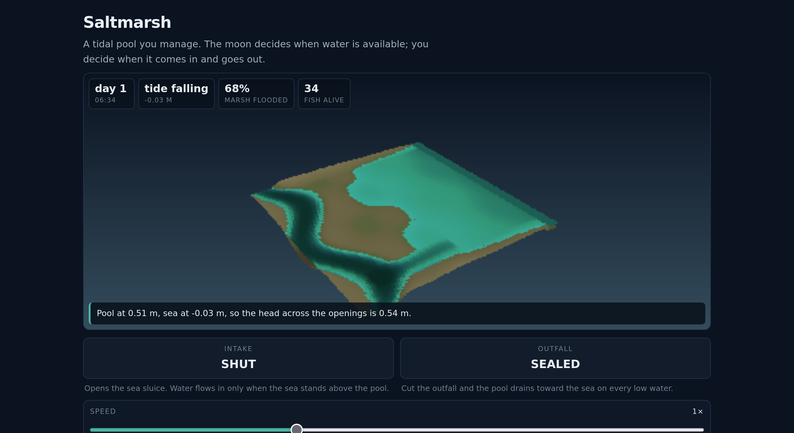

# Saltmarsh
<!-- Front page image: docs/desktop.png -->

**[▶ Play it live](https://raw.githack.com/thaumapolis/saltmarsh/main/index.html)** · [](https://github.com/thaumapolis/saltmarsh/actions/workflows/check.yml)

Run a tidal grazing marsh. The moon decides when water is available; you decide when it comes in and when it goes out. Get the timing wrong and everything on the flats dies.



## What you are looking at

A marsh cross-section in 3D: a meandering channel scoured below low water, a broad flat, and banks. The coloured surface is water — dark green where it is deep and productive, pale where it is a thin sheet over mud. **Vertical relief is exaggerated about 22×.** The real ratio here is 2.8 m of height across 520 m of width, which is 0.5%: drawn truthfully it would look flat, and a flat picture of a landscape whose entire subject is elevation tells you nothing. The amount is stated rather than hidden on purpose.

## What you can do

- **INTAKE** — open the sea sluice. Water flows in *only* while the sea stands above the pool.
- **OUTFALL** — cut an opening through the sea bank. The pool then drains toward the sea on every low water, and can be drained far below the level the tide would leave it.
- **Drag** to rotate the view, **pinch** or **scroll** to zoom.
- **Speed** up to 12×, and an intake size control.

The buttons do not move water. Only a head difference moves water, and the rate goes as the **square root** of that difference — so a big spring head empties the pool quickly and a slack neap barely moves it, and opening things at the wrong hour does nothing at all.

## Why it behaves like this

The mechanism is the **volume-elevation curve**. The same water sits shallow over a wide flat and deep in a narrow channel, so how much the level moves for a given inflow depends entirely on where the water already is. Sampled from the generated terrain:

| water level | marsh wetted |
|---|---|
| −0.6 m | 5% |
| −0.0 m | 10% |
| +0.3 m | 40% |
| +0.6 m | 82% |
| +0.9 m | 98% |

Its slope is the wetted area. That one fact produces everything else: a pool that fills fast and then stops moving, a channel that stays wet at the lowest tide, fringing marsh that exists for two hours a day, and a breach high on the bank doing something completely different from one low down.

The tides are **three harmonic constituents**, not a sine wave, because the interesting behaviour comes from their interaction:

- **M2** (lunar semidiurnal, 12.42 h) plus **S2** (solar semidiurnal, 12.00 h) beat against each other, giving a spring-to-spring cycle of **14.8 days**. Some days flood the whole marsh; some barely touch the flat.
- M2's period is 12 h 25 m, not 12 h, so flood times drift about 50 minutes later each evening.
- Adding the diurnal **K1** makes the two daily highs unequal, so one flood is much better than the other.

You are reacting to a calendar, not to a random number.

## The thing that can go wrong

Fish are not hiding from the tide — they come onto the flats on the flood because the shallow water is warm and productive and that is where they feed. They accept the risk. So:

- A fish needs depth to be safe from birds, and shallows to feed.
- A fish cannot cross a cell shallower than it can swim in.
- Therefore, **draining the pool faster than fish can return to the channel strands them in puddles**, with the refuge visible and unreachable.

This is not a scripted fail state — it is a consequence of depth, and the test suite asserts it in both directions over 14 simulated days:

| strategy | fish lost | first stranding |
|---|---|---|
| pool kept full, outfall sealed | **0 of 34** | never |
| sluice open whenever the sea is higher | **34 of 34** | day 0.9 |

Every death is recorded by the model itself as a stranding event, at a depth below the swim threshold — the test reads that log rather than inferring the cause from a snapshot. The same operation that feeds the marsh kills it, depending on the tide you timed it against.

## Controls

| key | action |
|---|---|
| buttons | toggle INTAKE / OUTFALL |
| drag | rotate the view |
| pinch / scroll | zoom |
| Speed slider | pause, 1×, 4×, 12× |
| Intake size | 0.3–6 m² |

Works with touch; portrait and landscape both lay out without clipping.

## Building and testing

Everything is pinned through Nix; no network is needed at runtime.

```console
$ nix develop --command ./check.sh     # build + all checks
$ nix build                            # the artifact alone
$ nix run .#default                    # (no-op: it is a file, open index.html)
```

`check.sh` runs four phases, all required:

1. **build** — concatenate `src/*.js` into one self-contained `index.html`.
2. **artifact guarantees** — no external file references, no web storage, no ES-module syntax left in the bundle.
3. **model** — 33 behavioural checks with no browser: volume conservation to float precision, flow direction and its √head scaling, the level-surface invariant, the gradient decaying without amplifying, and the trade-off itself (that one strategy loses fish and another loses none, with every death recorded by the model as a stranding below the swim-depth threshold).
4. **browser** — 13 checks against the **built** file: no page errors, the canvas holds a shaded landscape rather than a flat fill, the scene buffer is genuinely 4 bytes per pixel, dragging rotates the view, and the whole thing runs and paints inside a sandboxed opaque-origin iframe that reports its own state — so silence is a failure rather than a pass.

## Design notes

- **No WebGL.** The renderer is a software z-buffer on the CPU, because headless Firefox here returns `null` for both `webgl` and `webgl2` contexts. A full fill pass over the 96×96 heightfield measures about 7 ms, inside a 16.7 ms frame.
- **One length scale.** Elevations are in metres and plan position is normalised 0–1, which is how a landscape can be 278% as tall as it is wide while every individual number is perfectly reasonable. `MARSH_WIDTH_M` and `worldUnits()` make the ratio a single named definition.
- **Flux-form water update.** Each edge computes one signed flux, capped at what the source holds. The more obvious "adjust each cell by the gradient around it, then clamp at zero" form silently deletes water — 0.042% of the pool per 400 steps, which accumulates and makes "conservation" a lie.
- **Habitat-seeking, not depth-seeking.** With a seek-depth rule fish sit in the channel, never enter the marsh, and can never be stranded — four strategies gave four different water levels and 40/40 survivors every time. The game only exists once fish want the shallows.

Single file, no build step, no network, no storage.
